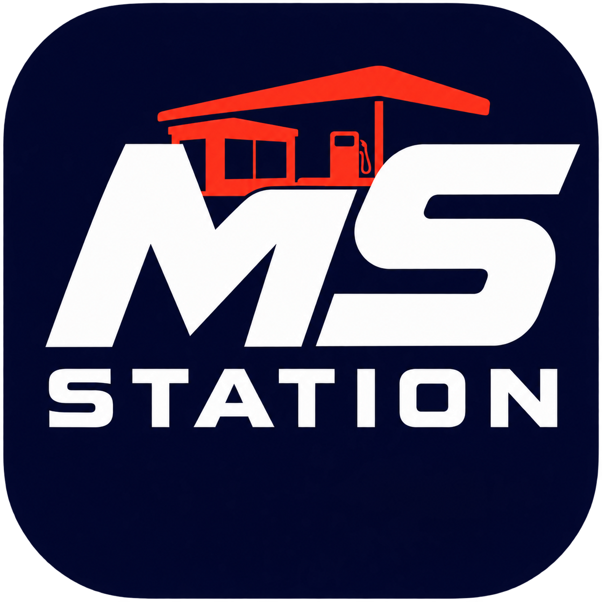
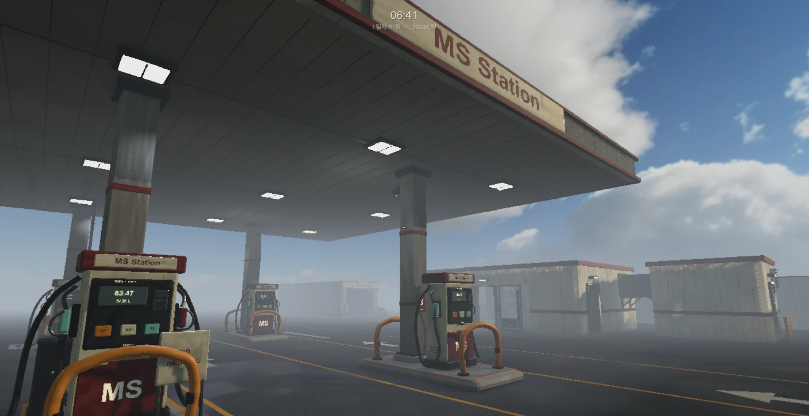
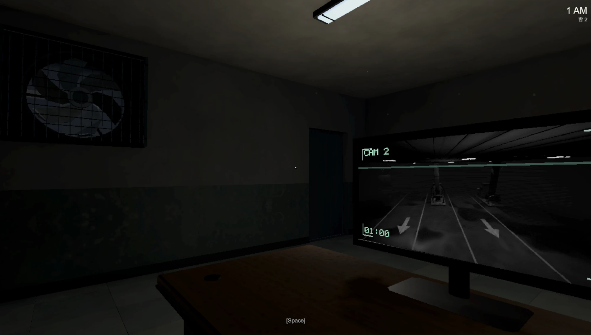
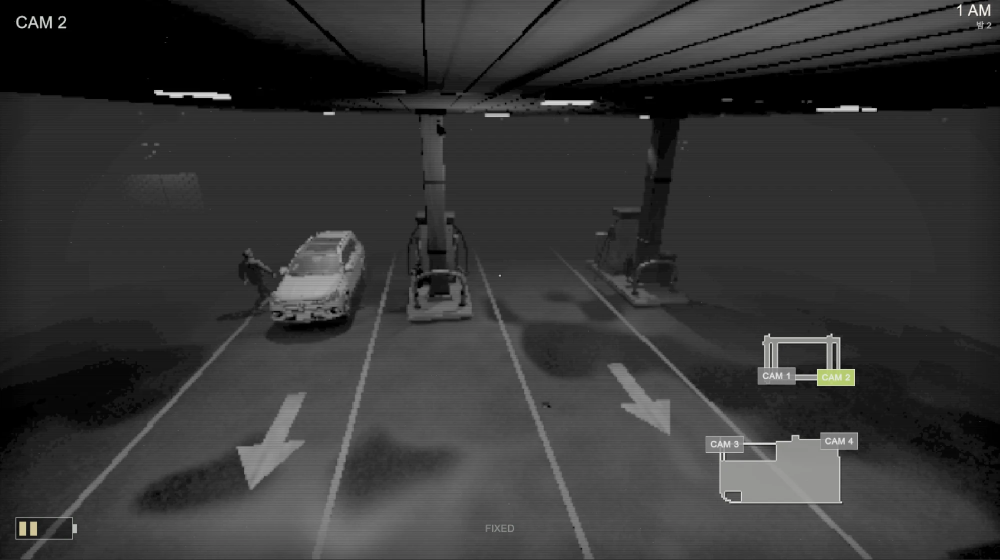

  

<h1 align="center">Midnight Station</h1>

  <b>자정부터 새벽 6시까지, 외딴 주유소의 야간 근무. 
  오늘 밤 들어오는 손님이 모두 사람이라는 보장은 없습니다.</b>

  1인칭 서바이벌 호러 · 자원 관리 &nbsp;|&nbsp; Unity 6 (URP) &nbsp;|&nbsp; Windows

---

## ⬇️ 다운로드

### 👉 [게임 다운로드 (v1.0)](https://github.com/hendrick-baek/craft-on-MS-MidnightStation/releases/tag/v1.0)

## ▶️ 실행 방법

1. 릴리즈 페이지에서 zip 파일을 받습니다.
2. **압축을 전부 해제**합니다. zip 안에서 바로 실행하면 안 됩니다.
3. 폴더 안의 게임 실행 파일(`.exe`)을 더블클릭합니다.
   같이 들어 있는 `_Data` 폴더와 `.dll` 파일들은 지우거나 옮기지 마세요.

> ⚠️ 처음 실행할 때 **"Windows의 PC 보호"** 창이 뜰 수 있습니다. 서명되지 않은 개인 제작 게임이라 뜨는 창입니다.
> **추가 정보 → 실행**을 누르면 됩니다.
>
> 🎧 **헤드폰이나 이어폰을 꼭 써 주세요.** 이 게임은 소리로 판단하는 게임입니다.

---

## 🎮 게임 소개

당신은 도시 외곽 주유소의 신입 야간 근무자입니다.
근무는 자정부터 새벽 6시까지. 손님은 차를 타고 와서 주유를 하고, 세차를 하고, 화장실을 씁니다.

그런데 이 주유소에는 **사람이 아닌 것**도 손님인 척 찾아옵니다.

사무실 책상에 앉아 **CCTV 화면**과 **숨소리 · 발소리**만으로 누가 사람이고 누가 괴물인지 가려내야 합니다.
사람에게는 친절하게 도와주고 팁을 받고, 괴물은 전기충격기로 막아내야 합니다.
하지만 잘못 판단해 사람에게 전기충격기를 쏘면 그 대가를 치르게 됩니다.

### 이런 재미가 있습니다

- 🔍 **불완전한 정보로 하는 판단**
  CCTV는 흐리고, 화면만으로는 확신할 수 없습니다. 귀를 기울이고, 손님의 행동을 지켜보고, 결정해야 합니다.
- ⚡ **빠듯한 전력 관리**
  문 잠금장치, 환풍기, 세차장 기계, 전기충격기 모두 전기를 씁니다. 전기가 바닥나면 문이 전부 풀리고, 그때부터 사무실은 안전하지 않습니다.
- 🚪 **사무실 밖으로 나가야 하는 순간들**
  세차장 기계가 멈추면 직접 나가서 고쳐야 하고, 화장실 손님도 챙겨야 합니다. 안전한 사무실을 떠날 때마다 긴장이 시작됩니다.
- 💰 **6일 밤을 버티는 생존**
  밤마다 번 돈을 정산하고, 낮에는 다음 밤을 준비합니다. 밤이 지날수록 손님도, 괴물도 달라집니다.
- 🕹️ **책상 위의 작은 게임기**
  조용한 밤에는 책상 위 휴대용 게임기로 미니게임을 할 수도 있습니다. 물론 한눈파는 사이 무슨 일이 생겨도 책임은 당신 몫입니다.

---

## ⌨️ 조작법

### 낮 · 걸어서 이동할 때

| 키 | 동작 |
|---|---|
| `W` `A` `S` `D` | 이동 |
| 마우스 | 둘러보기 |
| `Shift` (누른 채로) | 달리기 |
| `Ctrl` (누른 채로) | 웅크리기 |
| `E` | 상호작용 (문 열기, 물건 줍기 등) |

### 밤 · 사무실 책상에 앉아 있을 때

| 키 | 동작 |
|---|---|
| 마우스 | 둘러보기 |
| 마우스 왼쪽 클릭 | 상호작용 (문, 안내문, 게임기 등) |
| `Space` | CCTV 켜기 / 끄기 |

### 밤 · 사무실 밖에 나갔을 때

| 키 | 동작 |
|---|---|
| `Shift` | 주 행동 (화면에 표시되는 행동) |
| `Ctrl` | 보조 행동 (화면에 표시되는 행동) |
| `Space` | 사무실로 돌아가기 |

### 공통

| 키 | 동작 |
|---|---|
| `Esc` | 일시정지 · 설정 |

> 💡 책상 오른쪽의 **야간 근무 안내** 종이를 꼭 읽어 보세요. 근무 규칙이 적혀 있습니다.

---

## 📸 스크린샷

<!-- images 폴더에 스크린샷을 넣고 아래 파일 이름을 맞춰 주세요 -->

    
    
  

---

## 👥 팀원 소개

| 이름 | 역할 |
|---|---|
| 이름 | 기획 · 개발 |
| 이름 | 역할 |
| 이름 | 역할 |
| 이름 | 역할 |

---

## 🛠️ 개발 환경

- **엔진**: Unity 6.3 LTS (Universal Render Pipeline)
- **언어**: C#
- **플랫폼**: Windows (64-bit)

---

  2026 Craft:On 게임개발대회 <b>P.U.B.G.</b> 출품작

